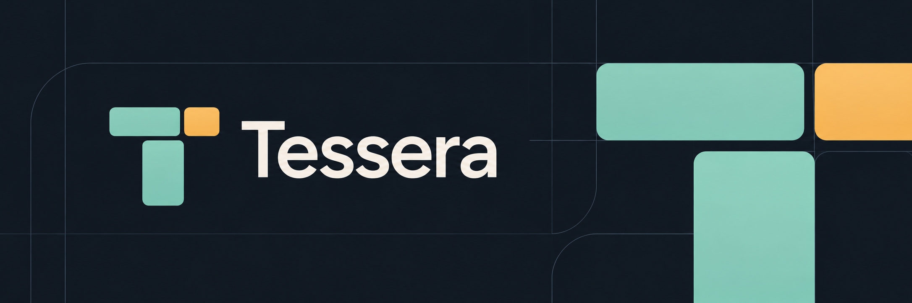
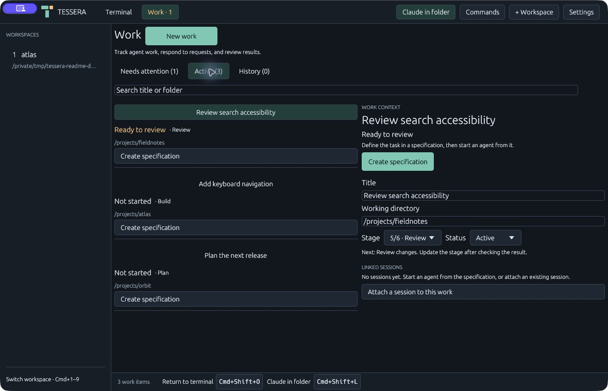
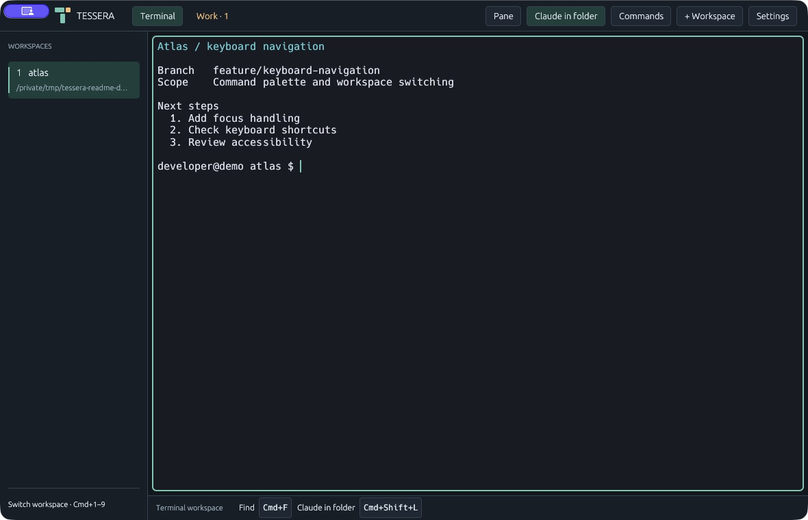

# Tessera

**Manage your work across Claude Code and Codex sessions.**

See which task needs a decision, keep related agent sessions together, and carry specifications and work stages beyond a single terminal session. Tessera brings that context into a native terminal workspace, so you can return to the CLI to review, approve, and act.

[Download](https://github.com/JeremySomsouk/tessera/releases) · [Getting started](#install) · [Documentation](docs/usage.md) · [Release notes](docs/releases/0.9.0.md)

Tessera runs on **macOS and Linux**, on Intel/AMD and ARM64. Built with Rust, with no browser runtime. Current version: **0.9.0 (alpha)**.

## A look inside

### Know which work needs you next

Work groups a task's directory, stage, specifications, and related sessions. Attention indicators help surface permission requests, input requests, and responses waiting for inspection. Move between Define, Plan, Build, Verify, Review, and Deliver yourself: an agent finishing a response does not mean the work is done.



### Act in the terminal you already use

Return to the linked terminal to respond to an agent or inspect its output. Run your usual shell in resizable panes, switch between project workspaces, and search terminal output. You can start with terminal multitasking and add work tracking as you need it.



*Screenshots show the actual macOS app with fictional projects and sample terminal text. No private session content is included. The terminal example is an illustrative task brief, not a live agent response.*

## Why Tessera

- **Work across agent sessions.** Group related Claude Code and Codex sessions around a shared task, with its directory, stage, and specification.
- **A clear next decision.** See agent activity and work stages without treating an agent's finished response as accepted work.
- **Local specifications.** Draft Markdown scope, save immutable revisions, and launch an implementation with a pinned revision.
- **Quick project access.** Open Claude in an existing folder with configurable search roots, or use the command picker to switch workspaces.
- **Local work history.** Keep task context and specifications after a terminal closes or the app restarts.

## Install

macOS or Linux, on x86-64 or ARM64:

```sh
curl -fsSL https://github.com/JeremySomsouk/tessera/releases/latest/download/install.sh | sh
tessera
```

No Rust toolchain or `sudo` needed. The installer verifies release checksums and installs the macOS app in `~/Applications` or the Linux executable in `~/.local/bin`. If needed, add that directory to your `PATH`:

```sh
export PATH="$HOME/.local/bin:$PATH"
```

Installer assets are available from 0.3.0 onward. You can also [build from source](docs/development.md) or download a [macOS release](https://github.com/JeremySomsouk/tessera/releases). macOS bundles are ad hoc signed; you may need to approve the first launch. Linux needs an X11/Wayland desktop and OpenGL/EGL runtime libraries. [Installation details](docs/installation.md)

## Connect your agents

Install Claude Code or Codex separately and sign in normally. Preview Tessera's hooks, then install the ones you use:

```sh
# Claude Code
tessera hooks
tessera install-hooks

# Codex
tessera codex-hooks
tessera install-codex-hooks
```

Run `claude` or `codex --no-daemon` in a Tessera pane. Codex's shared daemon can retain another pane's environment or an expired Tessera socket; `--no-daemon` keeps hooks attached to the current pane. Review the integration in `/hooks`; Codex requires trusting the definitions. Restart existing agent sessions if needed. Hook installation backs up existing configuration. [Integration details and uninstall](docs/integration.md)

Open local agents also appear before hooks arrive, labelled **Untracked** until lifecycle tracking starts. Approvals stay in the real CLI. Tessera records lifecycle and tool names, not prompts or transcripts. A finished response never accepts a task automatically.

## Everyday use

Use **Terminal** for shells and **Work** for task context. **+ Workspace** opens a directory. **Commands** finds workspaces and actions; **Pane** groups split and maximize controls. **Settings** holds appearance, folder search roots, terminal behavior, and updates.

**Claude in folder** searches existing folders by name and opens a terminal running `claude`. Configure **Search roots** there or in Settings to keep folder-name searches within selected directories. Pasting an exact existing path also works, including outside those roots.

On macOS, use Cmd below. On Linux, replace Cmd with Ctrl+Alt.

| Action | Shortcut |
| --- | --- |
| Commands / workspace picker | Cmd+Shift+P |
| Claude in folder | Cmd+Shift+L |
| Settings | Cmd+, |
| Work / previous terminal | Cmd+Shift+O |
| New workspace in the current directory | Cmd+N or Cmd+T |
| Split side by side / stacked | Cmd+D / Cmd+Shift+D |
| Focus neighboring split pane | Cmd+← / → / ↑ / ↓ |
| Maximize / restore pane | Cmd+Shift+Enter |
| Find in terminal | Cmd+F |
| Workspace 1–9 | Cmd+1–9 |
| Next session needing attention | Cmd+Shift+N |
| Stop focused pane | Cmd+W |

On macOS, Cmd+Enter inserts a newline in Claude Code without submitting. Drag to select terminal text; right-click for copy, paste, and search actions. [Full controls and keyboard reference](docs/usage.md)

## Specifications and agent launches

Select a work item to add a specification, edit its Markdown scope, and save a revision. Choose Claude or Codex, inspect the launch context, then use **Launch implementation** to start a new agent terminal in that directory. Launches remain linked to their pinned revision.

Stages are yours to change. Launching an agent does not advance a stage, and a finished response does not complete or accept the work. Approvals stay in the real CLI. [Work and specification guide](docs/usage.md)

## Local data and current limits

Preferences, work items, specifications, and bounded session histories are saved locally. Lifecycle tracking records events and tool names, not prompts or transcripts. Specification text is sent to the selected agent when you launch it.

Tessera is an alpha. It currently supports one window and local sessions. Each app launch opens a fresh terminal; previous tabs and splits are not restored, and retained work does not reconnect old processes. Quitting stops hosted shells. See [terminal compatibility](docs/terminal-compatibility.md) for renderer limitations.

The macOS app downloads signed updates and installs them when you quit. On Linux, rerun the installer. [Update details](docs/updates.md)

## Build from source

```sh
git clone https://github.com/JeremySomsouk/tessera.git
cd tessera
cargo run --locked
```

Rust stable is required. macOS needs Xcode Command Line Tools; Linux needs native GUI development libraries. [Build, validation, and release guide](docs/development.md)

## Documentation

[Installation](docs/installation.md) · [Usage](docs/usage.md) · [Agent integration](docs/integration.md) · [Architecture](docs/architecture.md) · [Roadmap](TODO.md)

## License

Tessera is open source under the [MIT license](LICENSE).
